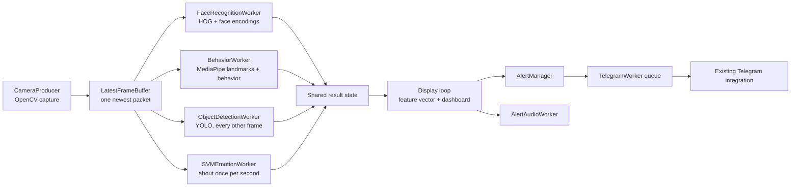

# Driver Anomaly Detection: Project Architecture and Metrics

This guide describes the repository as it currently exists. The active desktop
application is the packaged Python runtime under `src/driver_monitor`; the
Phase-2 and Phase-3 folders also contain standalone/legacy scripts and original
artifacts. A file being present in a phase folder does not mean the active
application executes it.

## 1. What the application does

The application reads one webcam stream and runs several independent analyses:

1. Face detection and known-driver identification.
2. Face-landmark based eye, mouth, head-pose, and behavior analysis.
3. Personalized eye-gaze calibration and gaze-distraction timing.
4. YOLO detection of phones, cigarettes, cups, and bottles.
5. An optional-information SVM emotion estimate, sampled independently.
6. A live dashboard, local audio alerts, and queued Telegram notifications.

It is a local monitoring prototype, not a certified vehicle-control system.
Emotion is informational rather than a safety judgment. A detected phone is not
by itself proof that the driver is using it: the phone alert path additionally
requires persistence, a confirmed driver, and proximity to the recognized
driver's face region.

## 2. Runtime architecture



### Startup, data flow, and shutdown

1. `python -m driver_monitor` enters through `src/driver_monitor/__main__.py`
   and `app.py`. The CLI dispatches either to the profile manager or the
   buffered monitor runtime.
2. `ProjectPaths` resolves model, profile, and legacy-script paths from the
   repository root. The legacy profile database is preferred when present;
   otherwise the local database under `data/local` is used.
3. Gaze calibration captures five directions (`FORWARD`, `LEFT`, `RIGHT`,
   `UP`, `DOWN`). The camera, gaze landmark detector, Telegram worker, and YOLO
   initialization can already be active during calibration. Instructions stay
   in a panel to the left of the camera preview; click a completed direction
   to retake that sample without losing the pending calibration step.
4. After calibration, recognition, behavior, object, SVM-emotion, audio, and
   display work proceed concurrently. Each vision worker requests the newest
   frame instead of building a queue of old frames.
5. Workers publish their own fields into the runtime result buffer. The
   display loop takes a snapshot, builds the optional 18-value feature vector,
   updates alerts/audio, draws the dashboard, and records timing statistics.
6. On quit (`q` or Escape), the runtime sets the stop event, wakes waiting
   workers, joins them, shuts down audio/Telegram resources, prints optional
   benchmark data, and closes OpenCV windows.

The camera buffer is single-slot: a newly captured packet replaces an older
unconsumed packet. This favors freshness over processing every frame. It can
avoid a growing backlog, but it does not guarantee that every detector finishes
every frame or that the whole application is lag-free.

### Current processing defaults

The defaults below are read from the active runtime's command-line parser;
command-line arguments can override them.

| Area | Default | Meaning |
|---|---:|---|
| Camera | index `0`, `800 x 600` | Capture device and requested size. |
| Face recognition | initial/retry interval `2.0 s`, resize `0.5`, tolerance `0.5`, 2 confirmations | HOG face locations and known-encoding matching. |
| Behavior | classifier threshold `0.65` | Used for the classifier's `talking`/`yawning` labels. |
| Head pose | yaw `25°`, pitch `20°` | Rule thresholds for looking away. |
| Eyes / fatigue | close EAR `0.21`, open EAR `0.24`, fatigue `1.5 s` | Hysteresis and prolonged closure thresholds. |
| Mouth | MAR `0.62` | Open-mouth rule threshold; additional counters are described below. |
| Gaze distraction | `0.6 s` | Required continuous non-forward gaze after debounce. |
| YOLO | image size `416`, base confidence `0.10`, IoU `0.45`, max 20 boxes | Model inference limits; each class also has its own minimum confidence. |
| YOLO cadence | every second captured frame | `OBJECT_DETECTION_FRAME_SKIP = 2`. |
| Phone validation | presence `0.3 s`, driver-use suspicion `0.75 s`, alert persistence `0.5 s` | Phone track and driver-association windows. |
| Emotion SVM | every `1.0 s` | Samples one fresh face crop; not every camera frame. |
| Behavior label smoothing | talking `0.35 s`, yawning `0.15 s`, distraction `0.10 s`, clear `0.15 s` | Separate persistence filters after raw behavior selection. |
| Telegram | cooldown `60 s`; yawn cooldown `10 s` | Notification rate limiting. |

The README's example command overrides the display size to `960 x 540`; that is
an example, not the parser default.

## 3. Detection metrics and calculations

### Face recognition

The active adapter calls the legacy `LiveDriverRecognition` implementation
loaded from the Phase-3 folder. Driver photos are encoded once at recognizer
initialization. While identity is unresolved, the worker retries at the
configured interval. Once confirmed, it skips recognition while the behavior
worker reports a visible face; after the configured 1-second face-loss grace,
it resets identity and resumes recognition. For each recognition sample:

1. Resize the frame by the configured scale and convert BGR to RGB.
2. Detect faces with the `face_recognition` HOG model.
3. Compute a face encoding and its Euclidean distance `d` to each stored
   encoding.
4. Select the smallest distance. A match is accepted when `d < tolerance`.
5. The displayed recognition score is `1 - d`; this is a distance-derived
   score, **not a calibrated probability**.
6. A known identity must meet the configured number of consecutive
   confirmations (default 2). A miss clears the confirmation counter.

Face boxes from the resized image are scaled back to the original frame for
display and for association with behavior/emotion regions.

### Facial geometry, behavior, and fatigue

The existing Phase-2 behavior module supplies a refined MediaPipe Face Mesh,
mouth/eye analyzers, head pose, and a trained Random Forest classifier.

**Eye aspect ratio (EAR).** For six ordered eye points `p1` through `p6`:

`EAR = (distance(p2,p6) + distance(p3,p5)) / (2 * distance(p1,p4))`

The runtime calculates left and right EAR and their average. The average at or
below `0.21` for two frames confirms closure; the average at or above `0.24`
for two frames confirms reopening. The gap between thresholds prevents rapid
open/closed toggling.

**Blink rate.** Completed closures are timestamped. Entries older than the
10-second window are discarded:

`blinks_per_minute = blink_count_in_10_seconds * 60 / 10`

The dashboard also reports the current count in that rolling window.

**Eye-closure fatigue.** Closure duration is elapsed monotonic time since the
closed state began. At `1.5 s` the eye analyzer raises its fatigue flag; an
open-eye recovery period clears the flag. The behavior label prioritizes this
fatigue rule over lower-priority behavior labels.

**Mouth aspect ratio (MAR).** The mouth analyzer uses normalized face
landmarks:

`MAR = distance(upper_lip, lower_lip) / max(distance(left_corner, right_corner), epsilon)`

The upper/lower points are landmarks 13/14; corners are 61/291. A yawn event
requires MAR at least `0.62` for 12 behavior frames and is cooldown-limited to
one event every 4 seconds. The active yawn state is cleared when MAR falls to
`0.52` or lower.

**Talking heuristic.** A rolling 24-frame MAR window is used. It calculates
the mean absolute difference between consecutive MAR samples and counts
crossings of the `0.62` open-mouth boundary. Talking is reported when the
mean change is at least `0.035`, there are at least two boundary transitions,
the window is full, and a yawn is not active. The classifier can also produce
`talking` or `yawning`, subject to its confidence gate.

**Head pose.** Six facial landmarks are paired with a fixed 3D face template.
OpenCV `solvePnP` estimates a rotation using a camera matrix with focal length
equal to image width and the image center as principal point. The first 45
valid rotations form a neutral baseline: their element-wise median is
projected to a rotation matrix using SVD. The current rotation is made
relative to neutral, converted to pitch/yaw/roll angles, and smoothed with an
exponential update:

`smoothed = 0.35 * current + 0.65 * previous`

The position rules use yaw `25°` and pitch `20°`. The behavior state machine
requires 18 consecutive turned frames before classifying prolonged head-turn
distraction and 8 forward frames for recovery; face-loss handling has a
12-frame grace in that state machine.

**Behavior classifier vector.** The active legacy model receives normalized
landmark x/y coordinates plus three relative head-pose angles. The vector
length is `2 * landmark_count + 3` (typically 959 when the refined mesh
provides 478 points). The shipped legacy training script fits a 300-tree
Random Forest with `class_weight="balanced_subsample"`, a stratified
80/20 train/test split, and a fixed random seed. It reports accuracy and a
per-class classification report. The live runtime reads the model's
`predict_proba` maximum and uses the configured `0.65` threshold for
classifier-only talking/yawning labels. Rule-based fatigue/distraction/yawn
signals have higher priority.

**Temporal behavior filtering.** The packaged worker applies a separate
temporal filter to reduce label flicker. Talking, yawning, and distraction
have their own persistence intervals; clearing an existing non-normal label
uses a clear interval. These are elapsed-time rules, not model confidence
values.

### Gaze

The gaze implementation uses refined MediaPipe iris landmarks 468 and 473.
For each eye, horizontal gaze position is the iris x coordinate within the
eye-corner width. Vertical position is the iris's y offset from the line
between eye corners, divided by that same width. The two eyes' normalized
positions are averaged. This makes the measurements less sensitive to face
size and camera distance than raw pixel coordinates.

During calibration, each of five directions is sampled for `1.5 s`; at least
8 valid samples are needed. The median x/y sample becomes that direction's
observation. Horizontal thresholds are placed halfway between forward and
the observed left/right position, with a minimum offset of `0.05`. Vertical
thresholds are the midpoint between forward and observed up/down. The code
records whether each direction is higher or lower in the user's camera
convention.

Every frame is classified by the strongest threshold crossing. A five-frame
vote smoother changes its output only when at least four votes agree.
Distraction requires a non-forward direction to persist continuously for the
configured duration (`0.6 s` by default); a forward or unavailable reading
resets the timer.

### YOLO objects and phone association

The adapter loads `models/objects/best_phone_finetuned_v1.pt`, validates the
model's class mapping, and uses CUDA if PyTorch reports CUDA available;
otherwise it specifies CPU inference. Inference uses:

| Class ID | Class | Per-class minimum confidence |
|---:|---|---:|
| 0 | Phone | 0.20 |
| 1 | Cigarette | 0.50 |
| 2 | Cup | 0.35 |
| 3 | Bottle | 0.40 |

In addition to the model's base confidence (`0.10`), detections below the
class minimum are discarded. The adapter also rejects unrecognized classes
and boxes whose area exceeds 85% of the frame. Ultralytics performs its model
post-processing with configured IoU `0.45` and maximum 20 detections.

Phone boxes are associated across processed frames using intersection over
union:

`IoU = intersection_area / union_area`

A match requires IoU greater than `0.1`. A phone becomes a confirmed persistent
track after at least two hits spanning `0.3 s`; tracks expire after more than
two missed detection frames or one second without an update. Driver-use
suspicion additionally requires a confirmed identity and a current phone-box
center inside a broad region around the recognized face. That suspicion must
persist `0.75 s`; the alert has a further `0.5 s` persistence setting.

**Display versus safety alert:** the camera view draws raw current object
boxes. The alert panel uses current object classes to choose the corresponding
object emoji/status instead of the normal “Drive safely” panel. This display
does not itself establish phone use. Phone safety-alert/notification logic
still requires the driver association and phone confirmation path.

### SVM emotion estimator

The active runtime starts `SVMEmotionWorker`, which loads
`models/emotion_classifier/best_emotion_model.pkl`,
`feature_names.pkl`, and `model_metadata.pkl` once. It requires a confirmed
driver and a recent behavior face region that overlaps the recognized driver
region. A crop is padded by one eighth of its width and height, clipped to
the frame, then analyzed with refined MediaPipe Face Mesh.

The feature extractor makes exactly 68 finite, ordered values:

- 12 geometric values: left/right EAR, EAR difference, mouth aspect ratio,
  normalized mouth width/opening, mouth-corner vertical delta, left/right
  brow-to-eye distances, brow-distance difference, and left/right brow slopes.
- 56 coordinate values: x/y for 28 selected eye, eyebrow, mouth, and face
  landmarks after centering the selected coordinates and scaling by
  interocular distance.

The original feature list and order are checked against the model metadata
before prediction. The classifier's `predict` result is a class label, not a
calibrated probability; the active dashboard does not display a confidence
percentage. Supported classes are angry, confused, disgust, fear, happy,
neutral, sad, shy, and surprise. Predictions are marked unknown when there is
no confirmed driver, the face is stale/mismatched, or the crop cannot be
processed. The worker also rejects frames older than 2 seconds and
face-state/frame-ID differences greater than 5 frames; for identity
association it requires at least 0.3 overlap measured as intersection divided
by the smaller of the two face-box areas.

The repository also contains a separate DeepFace emotion adapter, threshold
policy, and evaluation tool. Those are not the analyzer instantiated by the
current buffered runtime; do not confuse that evaluation pipeline with the
packaged 68-feature SVM path.

### Feature vector / “feature fusion”

`src/driver_monitor/fusion/features.py` constructs a fixed 18-value vector in
this order:

1. recognition confidence
2. recognition/driver-confirmed status
3. left EAR
4. right EAR
5. average EAR
6. blink count over 10 seconds
7. blink rate per minute
8. eye-closure duration
9. MAR
10. pitch
11. yaw
12. roll
13. fatigue flag
14. distracted flag
15. yawning flag
16. yawn-event flag
17. talking flag
18. behavior confidence

Numeric values that are missing, malformed, or non-finite become zero.
Boolean/status flags are mapped to `1.0` or `0.0`; recognition status prefers
the explicit confirmed flag. The vector is validated for length and finite
numeric values and placed in a record with driver name and timestamp. In the
active display loop this is a feature aggregation/output, not a new trained
fusion model and not a replacement for the detector outputs.

### Alert and dashboard timing metrics

The dashboard FPS is an exponentially smoothed render-loop rate:

`instant_fps = 1 / time_since_previous_render`

`fps = instant_fps` initially; thereafter `fps = 0.1 * instant_fps + 0.9 * previous_fps`.

This measures display-loop rate, not per-detector inference FPS.

`LatencyTracker` measures capture-to-render time for a changed combined-result
signature:

`latency = rendered_monotonic_time - captured_monotonic_time`

Repeated signatures are not counted. It retains up to 20,000 samples in the
runtime. Its summary reports sample count, count and fraction at/below the
2-second target, p50, p95, and maximum. Percentiles use the sorted
nearest-rank-style index `ceil(p * n) - 1`. These values are useful diagnostics;
they do not prove a specific user's camera, GUI, or computer is lag-free.

For model reports, **accuracy** is the number of correct predictions divided
by the number of evaluated examples. Per class, **precision** is
`TP / (TP + FP)`, **recall** is `TP / (TP + FN)`, and **F1** is the harmonic
mean `2 * precision * recall / (precision + recall)` (zero when both terms
are zero). A confusion-matrix cell counts examples with that actual row label
and predicted column label. The behavior training script reports accuracy and
per-class metrics; the emotion evaluation utility reports per-class precision,
recall, confusion counts, and the fraction classified as uncertain. These are
dataset metrics, not live-camera guarantees.

## 4. Alert, audio, and notification behavior

- Safety alerts are based on face/behavior/gaze/yawn/object state, not the
  emotion label.
- The alert manager prioritizes newly detected object classes, then fatigue
  event-window notifications, gaze distraction, sustained behavior
  distraction, and yawn notifications.
- Fatigue notifications require three distinct fatigue events within a
  60-second window. Driver distraction has a delay; yawn and general
  notifications have cooldowns.
- Local audio runs in its own worker, separate from camera and inference.
  Windows speech uses one persistent PowerShell/.NET speech synthesizer.
  Beeps are generated as 44.1 kHz, mono, signed 16-bit PCM sine waves with
  short fades. Runtime settings include fatigue speech cooldown, eye-closure
  beeps, distraction beeps/voice, two-beep yawn events, and talking alerts
  after four separate episodes (at most once every two minutes). `--mute`
  disables local audio.
- Telegram sends queued snapshots through the existing integration.
  Emotion fields and face bounds/crops are excluded from notification
  snapshots. Bot token and chat ID are read from
  `DRIVER_MONITOR_BOT_TOKEN` and `DRIVER_MONITOR_CHAT_ID`, not saved in code.
  Bottle detections are intentionally local-only in the current alert manager.

## 5. Requirements and component traceability

```mermaid
flowchart TD
    R1["FR-1 Capture live camera"] --> C["monitoring/camera.py + buffers.py"]
    R2["FR-2 Identify registered driver"] --> ID["detection/recognition.py + face_recognition_system.py"]
    R3["FR-3 Detect fatigue / behavior"] --> BH["detection/behavior.py + behavior model"]
    R4["FR-4 Detect gaze diversion"] --> G["detection/gaze.py + gaze calibration"]
    R5["FR-5 Detect objects"] --> O["detection/objects.py + object model"]
    R6["FR-6 Show informational emotion"] --> E["detection/svm_emotion.py + SVM worker"]
    R7["FR-7 Show live results"] --> UI["monitoring/legacy_runtime.py + UI modules"]
    R8["FR-8 Notify user"] --> A["monitoring/alerts.py + sound.py"]
    N1["NFR-1 Avoid stale-frame queue growth"] --> C
    N2["NFR-2 Isolate expensive work"] --> W["Independent workers"]
    N3["NFR-3 Preserve driver data compatibility"] --> P["profiles/repository.py + legacy pickle"]
    N4["NFR-4 Make performance measurable"] --> M["metrics.py + timing.py"]
```



| ID | Requirement / expected behavior | Main implementation |
|---|---|---|
| FR-1 | Capture frames, assign IDs/timestamps, and report camera errors. | `monitoring/camera.py`, `monitoring/buffers.py` |
| FR-2 | Match faces against registered profiles and show identity only after confirmation. | `detection/recognition.py`, legacy face recognizer, `FaceRecognitionWorker` |
| FR-3 | Estimate eye/mouth/head behavior and apply temporal rules. | Phase-2 behavior script, `detection/behavior.py`, `BehaviorWorker` |
| FR-4 | Calibrate gaze and detect sustained non-forward gaze. | Phase-3 gaze implementation, `detection/gaze.py` |
| FR-5 | Draw object classes and distinguish a raw phone detection from sustained driver-associated use. | `detection/objects.py`, `monitoring/temporal.py`, object worker |
| FR-6 | Display an emotion label only for a valid current driver face; do not use it as a safety signal. | `detection/svm_emotion.py`, `monitoring/workers.py`, `ui/live_dashboard.py` |
| FR-7 | Merge detector status and show camera, behavior, alert, object, and emotion state. | `monitoring/legacy_runtime.py`, `ui/alert_panel.py` |
| FR-8 | Play local alerts and queue supported Telegram notifications without blocking capture. | `monitoring/sound.py`, `monitoring/alerts.py` |
| NFR-1 | Prefer newest frames over an unbounded inference backlog. | Single-slot `LatestFrameBuffer` |
| NFR-2 | Run recognition, behavior, YOLO, and SVM independently. | Worker threads in `legacy_runtime.py` / `workers.py` |
| NFR-3 | Read/write the legacy profile pickle shape and keep photos locally. | `profiles/model.py`, `profiles/repository.py` |
| NFR-4 | Report timing and benchmark summaries without presenting them as guaranteed performance. | `monitoring/timing.py`, `monitoring/metrics.py` |

## 6. Source-file/module guide

### Package entry, configuration, and data types

| File | Responsibility |
|---|---|
| [`src/driver_monitor/__init__.py`](../src/driver_monitor/__init__.py) | Package marker and public package metadata. |
| [`src/driver_monitor/__main__.py`](../src/driver_monitor/__main__.py) | Implements `python -m driver_monitor`. |
| [`src/driver_monitor/app.py`](../src/driver_monitor/app.py) | CLI dispatch to live monitor or profile manager; forwards monitor options. |
| [`src/driver_monitor/config.py`](../src/driver_monitor/config.py) | Resolves repository, canonical model, local-data, profile, and legacy runtime paths. |
| [`src/driver_monitor/models.py`](../src/driver_monitor/models.py) | Shared frame packets, detector statuses, detection results, and emotion estimates. |
| [`src/driver_monitor/legacy.py`](../src/driver_monitor/legacy.py) | Loads retained Phase-2/Phase-3 algorithm modules by file path. |

### Detection and fusion

| File | Responsibility |
|---|---|
| [`src/driver_monitor/detection/__init__.py`](../src/driver_monitor/detection/__init__.py) | Detection package marker. |
| [`src/driver_monitor/detection/behavior.py`](../src/driver_monitor/detection/behavior.py) | Adapter functions for Phase-2 landmark, eye, mouth, pose, and behavior logic. |
| [`src/driver_monitor/detection/emotion.py`](../src/driver_monitor/detection/emotion.py) | DeepFace score adapter and threshold-policy logic; separate from the active SVM worker. |
| [`src/driver_monitor/detection/gaze.py`](../src/driver_monitor/detection/gaze.py) | Adapter for Phase-3 gaze calibration, classification, smoothing, and timing. |
| [`src/driver_monitor/detection/objects.py`](../src/driver_monitor/detection/objects.py) | YOLO model loading, class validation, inference, and box filtering. |
| [`src/driver_monitor/detection/recognition.py`](../src/driver_monitor/detection/recognition.py) | Adapter for loading profiles and matching face encodings. |
| [`src/driver_monitor/detection/svm_emotion.py`](../src/driver_monitor/detection/svm_emotion.py) | Loads and validates the nine-class SVM and exact 68-feature extractor. |
| [`src/driver_monitor/fusion/__init__.py`](../src/driver_monitor/fusion/__init__.py) | Feature-fusion package marker. |
| [`src/driver_monitor/fusion/features.py`](../src/driver_monitor/fusion/features.py) | Builds and validates the ordered 18-value monitoring feature vector. |

### Monitoring/runtime

| File | Responsibility |
|---|---|
| [`src/driver_monitor/monitoring/__init__.py`](../src/driver_monitor/monitoring/__init__.py) | Monitoring package marker. |
| [`src/driver_monitor/monitoring/legacy_runtime.py`](../src/driver_monitor/monitoring/legacy_runtime.py) | Main buffered runtime: workers, gaze calibration, result merge, alert flow, dashboard, CLI. The current object-panel display gives a present object class priority over the normal/safe panel. |
| [`src/driver_monitor/monitoring/buffers.py`](../src/driver_monitor/monitoring/buffers.py) | Single-slot latest-frame buffer and reusable thread-safe namespaced result buffer. The current legacy runtime owns its separate result-buffer class. |
| [`src/driver_monitor/monitoring/camera.py`](../src/driver_monitor/monitoring/camera.py) | OpenCV camera producer thread and capture error handling. |
| [`src/driver_monitor/monitoring/alerts.py`](../src/driver_monitor/monitoring/alerts.py) | Alert policy, alert priority, Telegram queue/worker, payload sanitation. |
| [`src/driver_monitor/monitoring/sound.py`](../src/driver_monitor/monitoring/sound.py) | Asynchronous generated beeps and Windows speech alert scheduling. |
| [`src/driver_monitor/monitoring/temporal.py`](../src/driver_monitor/monitoring/temporal.py) | Phone track association/persistence and driver-use suspicion state. |
| [`src/driver_monitor/monitoring/workers.py`](../src/driver_monitor/monitoring/workers.py) | Emotion workers. The active runtime instantiates `SVMEmotionWorker`; `EmotionWorker` is the separate DeepFace/threshold route. |
| [`src/driver_monitor/monitoring/metrics.py`](../src/driver_monitor/monitoring/metrics.py) | Capture-to-render latency sampling and percentile summary. |
| [`src/driver_monitor/monitoring/timing.py`](../src/driver_monitor/monitoring/timing.py) | Timestamped startup/inference stage logging. |
| [`src/driver_monitor/monitoring/session.py`](../src/driver_monitor/monitoring/session.py) | Reusable session lifecycle helper; the current legacy runtime manages its own worker lifecycle. |

### Profiles and user interface

| File | Responsibility |
|---|---|
| [`src/driver_monitor/profiles/__init__.py`](../src/driver_monitor/profiles/__init__.py) | Profile package marker. |
| [`src/driver_monitor/profiles/model.py`](../src/driver_monitor/profiles/model.py) | Typed profile fields, email/user-ID validation, legacy field conversion. |
| [`src/driver_monitor/profiles/repository.py`](../src/driver_monitor/profiles/repository.py) | Thread-safe profile CRUD/search and atomic pickle writes; optionally deletes only photos inside managed storage. |
| [`src/driver_monitor/profiles/controller.py`](../src/driver_monitor/profiles/controller.py) | UI-facing profile operations and explicit delete confirmation. |
| [`src/driver_monitor/ui/__init__.py`](../src/driver_monitor/ui/__init__.py) | UI package marker. |
| [`src/driver_monitor/ui/driver_profiles.py`](../src/driver_monitor/ui/driver_profiles.py) | Tkinter profile manager, search, photo import/capture, and CRUD actions. |
| [`src/driver_monitor/ui/live_dashboard.py`](../src/driver_monitor/ui/live_dashboard.py) | Emotion-label availability and emoji mapping helpers. |
| [`src/driver_monitor/ui/alert_panel.py`](../src/driver_monitor/ui/alert_panel.py) | Alert-panel text, colors, and emoji rendering with text fallback. |

## 7. Other repository folders and files

### Root and documentation

| Path | Purpose |
|---|---|
| [`README.md`](../README.md) | Project summary, setup commands, active entry points, model notes. |
| [`pyproject.toml`](../pyproject.toml) | Package metadata; supports Python `>=3.11,<3.12` and declares monitor, recognition, emotion, and test extras. |
| [`.gitignore`](../.gitignore) | Excludes generated/local files and environment artifacts. |
| [`local_emotion_test.py`](../local_emotion_test.py) | Standalone local emotion experiment/test script. |
| [`yolov8n.pt`](../yolov8n.pt) | Root-level YOLO artifact; the active packaged path is the fine-tuned model under `models/objects`. |
| [`docs/driver-monitoring-setup.md`](driver-monitoring-setup.md) | Install/runtime setup, limitations, model and privacy policy, compatibility notes. |

### Canonical models and local data

| Path(s) | Purpose / handling |
|---|---|
| [`models/behavior/driver_behavior_model.pkl`](../models/behavior/driver_behavior_model.pkl) | Canonical behavior classifier. |
| [`models/behavior/driver_behavior_labels.pkl`](../models/behavior/driver_behavior_labels.pkl) | Behavior label encoder paired with the classifier. |
| [`models/objects/best_phone_finetuned_v1.pt`](../models/objects/best_phone_finetuned_v1.pt) | Canonical YOLO object model. |
| [`models/face_landmarker/face_landmarker.task`](../models/face_landmarker/face_landmarker.task) | MediaPipe Tasks face-landmarker asset. The current Phase-2 detector uses the MediaPipe Solutions Face Mesh API. |
| [`models/emotion_classifier/best_emotion_model.pkl`](../models/emotion_classifier/best_emotion_model.pkl) | Packaged SVM classifier artifact. |
| [`models/emotion_classifier/feature_names.pkl`](../models/emotion_classifier/feature_names.pkl), [`models/emotion_classifier/model_metadata.pkl`](../models/emotion_classifier/model_metadata.pkl) | Required feature ordering and class/count metadata. |
| [`models/emotion_classifier/extract_features_v2.py`](../models/emotion_classifier/extract_features_v2.py) | Original 68-feature geometry extractor shared by training/inference code. |
| [`models/emotion_classifier/emotion_inference.py`](../models/emotion_classifier/emotion_inference.py) | Standalone single-image SVM inference utility; not the live camera loop. |
| `data/local/drivers_database.pkl` | Local driver profile database in legacy pickle format. |
| `data/local/driver_photos/01-d2e225e8.jpg`, `02-ef44ed38.jpg` | Local profile photographs; personal data. |
| `data/local/driver-seat-roi.json` | Local calibration data file retained in the project; the selected buffered runtime snapshot does not use this ROI path. |
| `models/emotion_classifier/__pycache__/...` | Generated Python bytecode cache, not a source/model input. |

Binary model files are described by their path and use; this guide does not
claim to inspect or validate their learned weights or provenance.

### Phase-1 research and planning

`Phase_1` is project documentation/research, not runtime code:

- `Project_Documentation/`: `README.md.txt`, `Problem_statement.md.txt`,
  `Objectives.md.txt`, `Scope.md.txt`, `Existing_Systems.md.txt`,
  `Literature_Survey.md.txt`, `Research_Technology_Gap.md.txt`,
  `Challenges.md.txt`, and `Phase_1_Summary.md.txt`.
- `Dataset_exploration/README.md.txt`, `Technology_Research/README.md.txt`,
  and `YawDD/data/README.md.txt`: dataset/technology notes.
- `YawDD/data/MIT_Licence.pdf`: dataset license document.
- `Reserch_papers/`: six research PDFs about abnormal driving, fatigue,
  computer-vision monitoring, deep learning, and anomaly detection.
- `Diagrams/ER_diagram.png`, `Diagrams/Master class diagram.jpeg`, and
  `references/idea.jpeg` / `references/referance.jpeg`: diagrams/reference
  images.
- `presentations/`: `Capstone_Project_Phase.pptx`,
  `Capstone_Project_Phase_–_1_-_Review_2_1[1].pptx`, and
  `Capstone_Project_Phase_–_1_End_semister_assigment_report.pptx`.

### Phase-2 retained scripts and training data

- `Phase-2/requirements.txt`: phase-level dependency list.
- `Phase-2/Face_monitoring_system/train_and_run_driver_detector.py`: behavior
  dataset loading/training and a standalone webcam runtime. Its data folders
  contain `distracted_pre/sample1.jpg` through `sample9.jpg`,
  `normal_pre/sample1.jpg` through `sample9.jpg`,
  `talking_pre/sample1.jpg` through `sample6.jpg` plus `samlle6.jpg`, and
  `yawning_pre/sample1.jpg` through `sample9.jpg`.
- `Phase-2/Face_monitoring_system/driver_behavior_model.pkl` and
  `driver_behavior_labels.pkl`: retained Phase-2 model copies.
- `Phase-2/Face_recognition_system/driver_app.py`: packaged profile-manager
  launcher; `driver_app_legacy.py`: older profile UI;
  `face_recognition_system.py`: standalone camera recognizer;
  `requirements.py`: old requirements helper/module;
  `DRIVER_APP_GUIDE.md` and `FACE_RECOGNITION_GUIDE.md`: operator guides.
- `Phase-2/Gaze_detection/gaze_detection.py` and `face_landmarker.task`:
  standalone gaze script and its Tasks model asset.
- `Phase-2/Object-Detection/webcam.py`, `requirements.txt`, and
  `best_phone_finetuned_v1.pt`: standalone object-detection script,
  dependencies, and model copy.

### Phase-3 buffered/legacy folder

All files below are under
`Phase-3/Buffered-system/buffered_system/Buffer/Buffered_system/`.

| File | Purpose |
|---|---|
| `buffered_driver_monitor.py` | Thin compatibility launcher into the packaged `legacy_runtime`. |
| `face_recognition_system.py` | Legacy live face-recognition module loaded by the current adapter. |
| `gaze_detection.py` | Gaze calibration/geometry implementation used by the current gaze adapter. |
| `train_and_run_driver_detector.py` | Retained behavior training/standalone runtime script. |
| `feature_fusion.py` | Historical feature-fusion implementation; active packaged vector lives under `src/driver_monitor/fusion/features.py`. |
| `integrated_driver_system_optimized.py` | Older combined/multiprocessing integration and Telegram source. |
| `driver_behavior_model.pkl`, `driver_behavior_labels.pkl` | Phase-3 model copies. |
| `best_phone_finetuned_v1.pt` | Phase-3 object-model copy. |
| `requirements.txt` | Phase-3 dependency list. |
| `BUFFERED_DRIVER_MONITOR_GUIDE.md` | Phase-3 monitor guide. |

### Emotion evaluation utility

[`tools/evaluate_emotion_model.py`](../tools/evaluate_emotion_model.py) evaluates
score manifests for the separate DeepFace policy. It requires disjoint
validation/held-out identities and minimum example/identity counts, selects
per-class cutoffs to reach at least `0.75` validation precision, then reports
held-out per-class precision/recall, confusion counts, and uncertain rate. A
class that fails the held-out precision gate is disabled. This is distinct
from the current nine-class SVM worker.

## 8. Test-file guide

Run the repository's documented deterministic test command from the root:

```powershell
python -m unittest discover -s tests -v
```

| Test file | Main area checked |
|---|---|
| `tests/unit/test_alert_panel.py` | Alert rendering, audio scheduling, cooldowns, mute, PCM waveforms. |
| `tests/unit/test_detection_adapters.py` | Behavior and gaze adapters preserve calls/data order. |
| `tests/unit/test_driver_profile_model.py` | Profile required fields, email checks, legacy mapping. |
| `tests/unit/test_driver_profile_repository.py` | Profile CRUD/search, legacy pickle compatibility, managed-photo deletion. |
| `tests/unit/test_emotion_mapping.py` | Emotion label/status mappings. |
| `tests/unit/test_emotion_model_evaluation.py` | Evaluation data partitioning, thresholds, metrics, identity leakage. |
| `tests/unit/test_svm_emotion.py` | SVM artifact/order, sampling, stale frames, driver-face matching, worker isolation. |
| `tests/unit/test_latency_metrics.py` | Changed-signature samples, latency summaries, timestamp validation. |
| `tests/unit/test_live_dashboard.py` | Emotion display status and emojis; separation from safety alerts. |
| `tests/unit/test_project_paths.py` | Project path and canonical artifact resolution. |
| `tests/unit/test_temporal_detection.py` | Phone persistence, box matching, driver association, expiry. |
| `tests/integration/test_combined_monitoring.py` | Detector state coexistence and emotion/safety isolation. |
| `tests/integration/test_driver_profile_ui.py` | Profile workflow, photo upload/capture, deletion confirmation. |
| `tests/integration/test_emotion_non_persistence.py` | No persistent emotion storage. |
| `tests/integration/test_emotion_worker_isolation.py` | Emotion failure/status behavior without taking down monitoring. |
| `tests/integration/test_existing_detection_compatibility.py` | Legacy recognition, YOLO mapping, feature order, alert, and Telegram compatibility. |
| `tests/integration/test_legacy_entrypoints.py` | CLI, profile launcher, and Phase-3 launcher compatibility. |
| `tests/__init__.py`, `tests/unit/__init__.py`, `tests/integration/__init__.py` | Python test package markers. |

The tests are deterministic checks and mostly mock hardware/external services.
Passing them does not by itself validate a live webcam session, real driver
recognition, GPU execution, alert audibility, Telegram credentials, or
real-world accuracy.

## 9. Dependencies, configuration, and limitations

- `pyproject.toml` constrains the supported interpreter to Python 3.11 and
  groups optional monitor, face-recognition, and emotion dependencies.
- OpenCV/MediaPipe handle image and landmark processing; `face-recognition`
  provides face encodings; scikit-learn hosts the behavior/SVM models;
  Ultralytics/PyTorch run YOLO; Pillow enables emoji rendering.
- The emotion extra also includes TensorFlow/DeepFace for the separate
  thresholded emotion route/evaluation code. OpenCV dependencies overlap, so
  the setup guide warns that the combined extras are not fully
  cross-platform-release-validated.
- On Windows, the `face-recognition`/dlib dependency may need Visual Studio
  C++ build tools. See `docs/driver-monitoring-setup.md`.
- Driver profiles and images remain local; profile records use Python pickle.
  Do not load profile databases from untrusted sources. Telegram credentials
  are process environment variables and should not be committed.
- Class thresholds, heuristics, and scores are implementation settings, not
  medical/driver-safety certification. The emotion model does not establish a
  driver's internal emotional state.
- The project contains canonical model files and duplicate legacy copies.
  Their presence does not establish their training data provenance, live
  accuracy, or runtime compatibility on every machine.

## 10. Run commands

From the repository root, using a compatible installed environment:

```powershell
python -m driver_monitor --benchmark
python -m driver_monitor --profiles
python -m unittest discover -s tests -v
```

The alternate Phase-3 path
`Phase-3/Buffered-system/buffered_system/Buffer/Buffered_system/buffered_driver_monitor.py`
is a compatibility launcher for the same packaged monitoring runtime; it is
not a second, independent camera pipeline.
